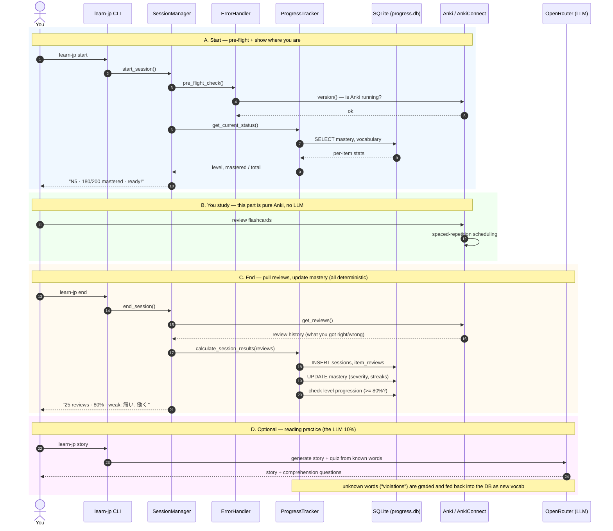
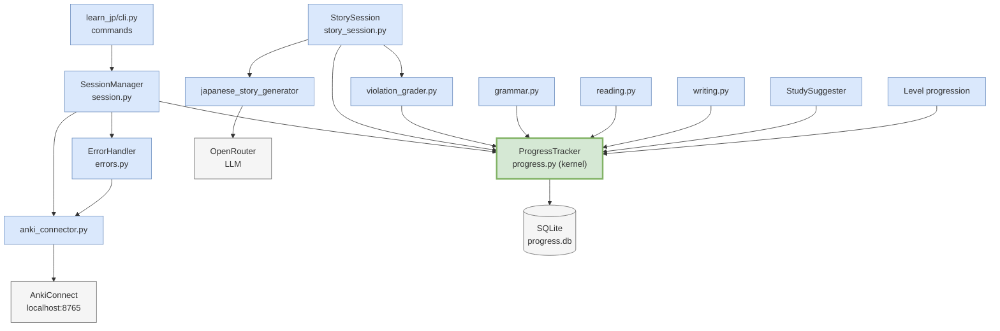

# learn-jp — How the Parts Fit Together (in a real study session)

This is the "story" version of [ARCHITECTURE.md](ARCHITECTURE.md): what each part is, how they relate, and what actually happens when you sit down to study for 20 minutes.

> The diagrams below are **Mermaid** — they render live in VS Code's Markdown preview (`Ctrl/Cmd+Shift+V`) and on GitHub. An editable draw.io version is at [`learn-jp-architecture.drawio`](learn-jp-architecture.drawio).

---

## 1. The parts, at a glance

| Part | File(s) | Role in plain English |
|------|---------|----------------------|
| **You** | — | Do the actual studying (drill cards, read stories) |
| **CLI** | `learn_jp/cli.py` | The command menu you type into (`start`, `end`, `status`, `story`, …) |
| **SessionManager** | `learn_jp/session.py` | The conductor — runs one study session start to finish |
| **ProgressTracker** | `learn_jp/progress.py` | **The kernel.** Decides what you've mastered, logs every session, powers every readout |
| **ErrorHandler** | `learn_jp/errors.py` | Pre-flight checks ("is Anki running?") before a session starts |
| **StorySession / violation_grader** | `learn_jp/story_session.py`, `violation_grader.py` | Turns an LLM story into learning: find unknown words ("violations") and feed them back as new vocabulary |
| **SQLite DB** | `progress/progress.db` | Long-term memory — mastery, sessions, item history, config |
| **Anki + AnkiConnect** | `lib/anki_connector.py` | The drill engine. Anki schedules spaced repetition; AnkiConnect is the API bridge on `localhost:8765` |
| **OpenRouter** | `japanese_story_generator` pkg | The ~10% LLM bit: generates stories, questions, writing feedback |
| **Jisho API** | `lib/jisho_client.py` | Dictionary lookups (readings, meanings) when enriching vocabulary |

**The one relationship that matters most:** almost everything routes through **ProgressTracker**. Every feature writes to it, every status screen reads from it. That's why it's the kernel — and the thing to build first.

---

## 2. What happens in a real study session



**Reading the flow:**
- **Phases A and C are the daily loop** — fully deterministic, no LLM, no cost. `start` → study in Anki → `end`.
- **Phase B is deliberately outside learn-jp.** Anki owns spaced-repetition scheduling; learn-jp just reads the results.
- **Phase D is optional and is the only LLM step.** Its output (unknown words) loops back into the DB, so the curriculum adapts to you.

---

## 3. Who depends on whom (static view)



This is why **ProgressTracker is the build-first priority**: seven separate modules point at it. `ErrorHandler` and `anki_connector.py` are the only other pieces with more than one dependent — and `anki_connector.py` already exists and works.

---

## 4. The layered picture

```
┌──────────────────────────────────────────────────────────────────────┐
│  PRESENTATION   start · end · status · story · grammar · write        │
└────────────────────────────────┬─────────────────────────────────────┘
                                 ▼
┌──────────────────────────────────────────────────────────────────────┐
│  ORCHESTRATION   SessionManager              StorySession             │
└────────────────────────────────┬─────────────────────────────────────┘
                                 ▼
┌──────────────────────────────────────────────────────────────────────┐
│  DOMAIN KERNEL   ProgressTracker · ErrorHandler · violation_grader    │
│                  (mastery rules, session logging, level thresholds)   │
└───────┬──────────────────────────────────────────────────┬───────────┘
        ▼                                                  ▼
┌───────────────────────┐                    ┌──────────────────────────┐
│  DATA (local, free)   │                    │  EXTERNAL (remote)       │
│  SQLite progress.db   │                    │  AnkiConnect :8765       │
│  mastery · sessions · │                    │  OpenRouter (LLM, 10%)   │
│  item_reviews · config│                    │  Jisho (dictionary)      │
└───────────────────────┘                    └──────────────────────────┘
```

- **Downward = "uses".** The CLI uses orchestration, orchestration uses the kernel, the kernel talks to data + external services.
- **Data is local and cheap; external is remote.** SQLite and AnkiConnect are deterministic and free. OpenRouter is the only LLM/cost, and only the feature leaves reach it.

---

## 5. What this means for build order

1. **`learn_jp/progress.py` (ProgressTracker + mastery engine)** ← build first (7 dependents, the kernel)
2. `learn_jp/config.py` + `learn_jp/errors.py` (small; unblock `start`)
3. `learn_jp/session.py` (SessionManager) → **first usable CLI loop: `start` / `end` / `status`**
4. Feature leaves, each only pulling the LLM when needed: `violation_grader` → `reading` → `grammar` → `writing` → `story_session`

`lib/anki_connector.py`, the DB schema (now v2), and the `japanese_story_generator` package are **already done**, so step 1 is the real starting line.
